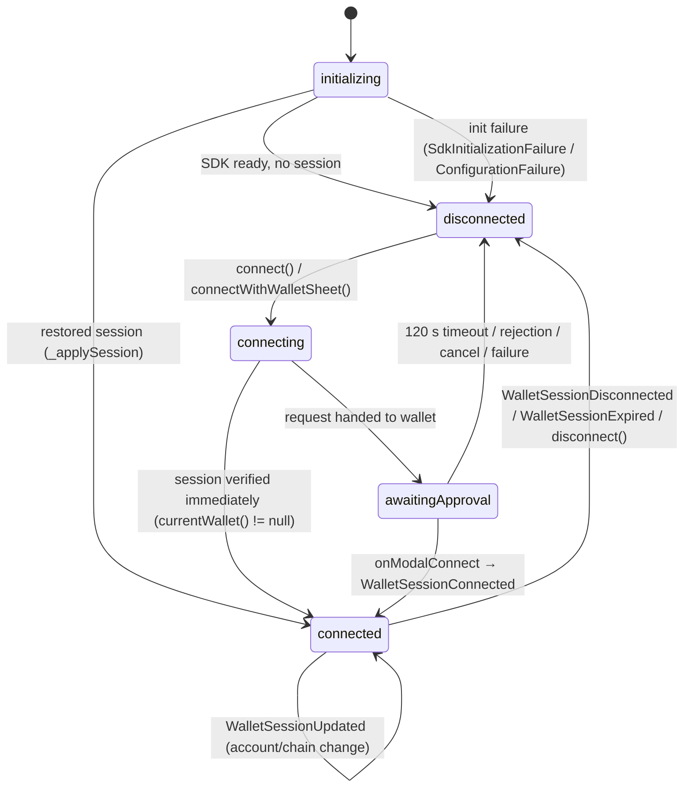
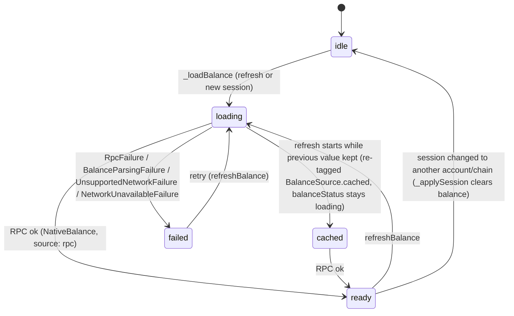

# Architecture and Flow — MetaOwn Connect

> Audience: a developer joining the project. All file paths are relative to the repo root unless stated otherwise. Branch at time of writing: `stage/v1` (single commit `383f7c3` plus uncommitted work — see `IMPLEMENTATION_LOG.md`).

## 1. What was built

MetaMask wallet connectivity was added to a Flutter app that previously contained only the default counter demo screen (that demo has since been removed; `lib/features/home/home_page.dart` is now a plain landing tab). The app now connects to MetaMask Mobile (and any other WalletConnect-compatible wallet) through **Reown AppKit** (WalletConnect v2) via `lib/features/wallet/services/wallet_connection_service.dart`, tracks connection and balance lifecycles with Riverpod, and displays the connected EVM address, network, chain ID and native-token balance on a new Wallet page (`lib/features/wallet/views/wallet_page.dart`) reached from a new bottom-nav shell (`lib/features/wallet/views/home_shell.dart`). Balances are read over HTTPS JSON-RPC `eth_getBalance`; the connection is real — no address is ever hardcoded or simulated.

## 2. Tech stack

| Concern | Choice | Where |
|---|---|---|
| Framework | Flutter 3.35.7 (stable, rev `adc9010625`), Dart `>=3.9.2 <4.0.0` | `.metadata`, `pubspec.lock` (`sdks:`) |
| Wallet SDK | `reown_appkit: ^1.9.0` (resolved **1.9.0**; transitive `reown_core` 1.5.1, `reown_sign` 1.4.1) | `pubspec.yaml`, `pubspec.lock` |
| State management | `flutter_riverpod: ^3.3.2` (resolved **3.3.2**; transitive `riverpod` 3.3.2) | `pubspec.yaml` |
| HTTP | `http: ^1.6.0` (resolved **1.6.0**) | `pubspec.yaml` |
| Service locator | `get_it: ^9.3.0` (resolved **9.3.0**) — used by the AppKit SDK internally; the app resolves `IExplorerService` from it, it is not the app's own DI | `pubspec.yaml`, `wallet_connection_service.dart:205` |
| Lints | `flutter_lints: ^5.0.0` (dev) | `pubspec.yaml` |
| Platforms | Android + iOS (Linux/macOS/Windows plugin registrants regenerated, not targeted) | `android/`, `ios/` |

## 3. MVVM mapping

| Layer | Classes | Files |
|---|---|---|
| **View** | `WalletPage` (`ConsumerStatefulWidget`), `HomeShell`, `HomePage`, `ConnectMetaMaskButton`, `ConnectedWalletCard`, `WalletBalanceCard`, `WalletConnectionStatus`, `NoticeBanner`, `ErrorBanner`, `MetaMaskMark` | `lib/features/wallet/views/wallet_page.dart`, `lib/features/wallet/views/home_shell.dart`, `lib/features/home/home_page.dart`, `lib/features/wallet/views/widgets/*.dart` |
| **ViewModel** | `WalletViewModel` (Riverpod `Notifier<WalletViewState>`), `walletViewModelProvider` | `lib/features/wallet/viewmodels/wallet_view_model.dart`, `lib/features/wallet/viewmodels/wallet_providers.dart` |
| **Model — services (SDK boundary)** | `IWalletConnectionService` / `WalletConnectionService`; events: `WalletSessionConnected`, `WalletSessionUpdated`, `WalletSessionDisconnected`, `WalletSessionExpired`, `WalletConnectionFailed` | `lib/features/wallet/services/wallet_connection_service.dart`, `lib/features/wallet/services/wallet_service_events.dart` |
| **Model — data** | `WalletRepository`, `IBlockchainBalanceService` / `BlockchainBalanceService` | `lib/features/wallet/data/wallet_repository.dart`, `lib/features/wallet/data/blockchain_balance_service.dart` |
| **Model — pure data** | `ConnectedWallet`, `BlockchainNetwork` + `BlockchainNetworkRegistry`, `NativeBalance`, `BalanceFormatter`, `BalanceSource`, sealed `WalletFailure` hierarchy, `WalletViewState`, `WalletStatus`, `BalanceStatus` | `lib/features/wallet/models/*.dart` |

**Why the Model layer is split three ways:**

- `services/` is the only package that may import `reown_appkit`/`get_it`. `WalletConnectionService` owns the `ReownAppKitModal` instance, translates SDK events into the sealed `WalletServiceEvent` union, and converts sessions into `ConnectedWallet` (`_toWallet`, `wallet_connection_service.dart:310`). **No SDK type ever escapes this class** — everything above the service boundary (repository, ViewModel, views, tests) works with pure Dart models, which is exactly what makes the ViewModel unit-testable with fakes.
- `data/` coordinates: `WalletRepository` is a thin façade over the two service interfaces; `BlockchainBalanceService` owns HTTP/JSON-RPC concerns (endpoint fallback, timeouts, wei parsing) and throws only typed `WalletFailure`s.
- `models/` is pure, immutable, SDK-free data (`@immutable` classes, enums, formatters) shared by every layer — the contract of the feature.

## 4. Riverpod provider graph

Defined in `lib/features/wallet/viewmodels/wallet_providers.dart`:

```text
appConfigProvider                    Provider<AppConfig>  ← AppConfig.fromEnvironment()
        │
        ├──────────────────────────────┐
        ▼                              ▼
walletConnectionServiceProvider   blockchainBalanceServiceProvider
  Provider<IWalletConnectionService>  Provider<IBlockchainBalanceService>
  (onDispose → service.dispose)       (owns http.Client; onDispose → client.close)
        │                              │
        └──────────┬───────────────────┘
                   ▼
        walletRepositoryProvider      Provider<WalletRepository>
                   │
                   ▼
        walletViewModelProvider       NotifierProvider<WalletViewModel, WalletViewState>
```

- `WalletViewModel.build()` obtains the repository with `ref.read(walletRepositoryProvider)` (`wallet_view_model.dart:37`) and subscribes to `repository.connectionEvents`; `ref.onDispose(_release)` cancels the event subscription and the approval timer.
- **Test injection point:** fakes implementing `IWalletConnectionService` and/or `IBlockchainBalanceService` are injected by `ProviderScope(overrides: [...])` overriding `walletConnectionServiceProvider` and/or `blockchainBalanceServiceProvider` — the repository and ViewModel pick them up automatically through the graph.
- `main.dart` wraps the app in `ProviderScope`; `MetaOwnConnectApp` watches `appConfigProvider` for the `MaterialApp.title`.

## 5. The state machine

Two **independent** state machines live on the single immutable `WalletViewState` (`lib/features/wallet/models/wallet_view_state.dart`): `WalletStatus` (connection) and `BalanceStatus` (balance read). They are separate because a successful connection must never imply a successful balance read — `_applySession` sets `status: connected` first, then triggers `_loadBalance` asynchronously; the balance may end in `failed` while the session stays `connected`. `WalletViewState` also keeps **two distinct failure slots**: `connectionFailure` and `balanceFailure`.





Rules worth knowing:

- `canStartConnection` (`!isConnecting && !isConnected && !isInitializing`) blocks duplicate connection requests; `_startConnection` re-checks it.
- `_failConnection` (`wallet_view_model.dart:297`): a `UserCancelledFailure` is treated as a quiet notice, not an error; a secondary error while already connected never tears down the live session.
- `isUnsupportedNetwork` (`isConnected && network == null`) keeps the session but disables chain-specific actions (`canRefreshBalance` is false).

## 6. Connection flow, end to end

1. **`WalletPage.initState`** (`wallet_page.dart:24`) — reads `walletViewModelProvider` (forces build) then calls `initialize(context)` un-awaited. The `context` sits below the app `Navigator` so AppKit can present its modal sheet.
2. **`WalletViewModel.initialize`** (`wallet_view_model.dart:48`) — idempotent (`_started` guard, never throws); delegates to `repository.initialize(context)`.
3. **`WalletConnectionService.initialize`** (`wallet_connection_service.dart:79`) — idempotent via a shared `_pendingInitialization` future; delegates to `_doInitialize`.
4. **`_doInitialize`** — throws `ConfigurationFailure` if `AppConfig.isConfigured` is false (empty project id); constructs `ReownAppKitModal(context:, projectId:, metadata: PairingMetadata(name, description, url, icons, redirect: Redirect(native: '<scheme>://', universal: '<appUrl>/wallet', linkMode:)), featuredWalletIds: {kMetaMaskWalletId}, enableAnalytics:, logLevel: LogLevel.nothing, disconnectOnDispose: false)`; attaches event handlers; `await modal.init()`; `modal.status.isError` → `SdkInitializationFailure`. Any other exception is swallowed and rethrown as `SdkInitializationFailure` (raw SDK errors never leak). A restored session (if any) is applied immediately via `repository.currentWallet()` → `_applySession`.
5. **User taps `Connect MetaMask`** → `viewModel.connect()` → `_startConnection(useMetaMask: true)`. Status becomes `connecting`, balance state is reset.
6. **`WalletConnectionService.connectMetaMask`** (`wallet_connection_service.dart:127`) — no-ops if already connected; then **`_resolveMetaMaskWallet`**: takes `GetIt.I<IExplorerService>()` (the SDK-registered explorer), `await explorer.init()` if needed, then polls `explorer.listings.value` every 200 ms for up to **8 s** for a wallet whose `listing.id == kMetaMaskWalletId` (the well-known WalletConnect explorer id constant) or whose `listing.name` lowercases to `metamask`.
7. **Resolved** → `modal.selectWallet(metaMask)` + `await Future.delayed(Duration.zero)` (lets the async selection settle) + `await modal.connectSelectedWallet()` — AppKit deep-links into **MetaMask Mobile** using the `metamask:` scheme (declared in the native `<queries>` / `LSApplicationQueriesSchemes`).
   **Not resolved** (explorer unreachable, timeout, GetIt miss) → **fallback**: `modal.openModalView(const ReownAppKitModalAllWalletsPage())` — the SDK's own all-wallets sheet, the supported alternative connection method (also reachable directly via `viewModel.connectWithWalletSheet()` / the "Browse all wallets" button).
8. When `connectMetaMask` returns and `repository.currentWallet()` is still `null`, status becomes **`awaitingApproval`** and `_startApprovalTimer()` arms a fixed **120 s** `Timer(approvalTimeout)`; on expiry the connection is cleared with `ConnectionTimeoutFailure`.
9. **Approval in MetaMask** → AppKit fires `onModalConnect` → handler `_toWallet(event.session)` (validates address via `ConnectedWallet.isValidEvmAddress`, extracts namespace address via `NamespaceUtils.getNamespaceFromChain`) → emits `WalletSessionConnected(wallet)` (or `WalletConnectionFailed(InvalidAccountFailure)` if the session is invalid).
10. **`WalletViewModel._onServiceEvent`** → `_applySession(wallet)`: re-validates the address, cancels the approval timer, sets `status: connected`, clears balance state unless the wallet is unchanged (same address + chain), then `_loadBalance(wallet)`.
11. **Balance fetch** (§7) runs; the address is now on screen via `ConnectedWalletCard` immediately, with the balance arriving when the RPC answers.
12. A user **cancel** in the approval UI surfaces as `onModalError` → `mapModalError` → `UserCancelledFailure` → `_failConnection` treats it as a notice and returns quietly to `disconnected` — no false success.

## 7. Balance retrieval

`BlockchainBalanceService.fetchNativeBalance` (`lib/features/wallet/data/blockchain_balance_service.dart:43`):

- Pre-validates the address (`InvalidAccountFailure`) and that every endpoint is HTTPS (`network.hasSecureRpcUrl`, else `RpcFailure`).
- Tries endpoints in order: the network's primary `rpcUrl`, then `fallbackRpcUrl` on failure. `BalanceParsingFailure` is **not** retried (the node answered; the data is bad).
- Primary endpoint for every registry network is **`https://rpc.walletconnect.org/v1`**; for that host `_withParameters` appends `chainId=<numeric>` and `projectId=<public Reown project id>`. The public-node fallbacks (`*.publicnode.com`) are called as-is. A WalletConnect host with an empty project id is skipped (`_isUsable`).
- Request: JSON-RPC 2.0 `eth_getBalance` with params `[address.toLowerCase(), 'latest']`, 20 s timeout. Non-2xx → `RpcFailure`; JSON-shape problems → `BalanceParsingFailure`; an `error` member → `RpcFailure`.
- **Wei is a `BigInt` end to end**: `BalanceFormatter.parseWeiFromHex` (`native_balance.dart:38`) strips `0x` and does `BigInt.parse(..., radix: 16)`. **`BalanceFormatter.format` is integer-only** — `BigInt` division/modulo with **round-half-up** (`remainder * BigInt.two >= divisor`), trailing-zero trimming, and `,` thousands grouping. **No floating point ever touches a financial value.**
- **Stale-response guard:** `_loadBalance` increments `_balanceRequestId` per call; every completion path checks `_isCurrentBalanceRequest(requestId, wallet)` (`wallet_view_model.dart:250`) which requires the request id to still be current *and* the current session's address (case-insensitive) and chainId to match the wallet the request was made for. A slow RPC response for a previous account/chain is silently dropped. `_clearConnection` also bumps `_balanceRequestId` to invalidate everything in flight on disconnect.
- **Cached vs live:** `BalanceSource` (`rpc` | `cached`) is stamped on `NativeBalance`. During a refresh of the *same* wallet, the previous value is kept but re-tagged `cached` while status is `loading`; `WalletBalanceCard` shows "· Live from RPC" or "· Cached value" in its caption. Account/chain changes always clear the balance — a cached value never crosses accounts.

## 8. Network support

`BlockchainNetworkRegistry` (`lib/features/wallet/models/blockchain_network.dart:80`) — CAIP-2 chain ids (`eip155:<id>`):

| Network | Chain ID | Symbol | Primary RPC | Fallback RPC | Explorer | Testnet |
|---|---|---|---|---|---|---|
| Ethereum Sepolia (**dev default**, `defaultNetwork`) | `eip155:11155111` | ETH | `https://rpc.walletconnect.org/v1` | `https://ethereum-sepolia-rpc.publicnode.com` | sepolia.etherscan.io | yes |
| Ethereum | `eip155:1` | ETH | same primary | `https://ethereum-rpc.publicnode.com` | etherscan.io | no |
| Polygon | `eip155:137` | POL | same primary | `https://polygon-bor-rpc.publicnode.com` | polygonscan.com | no |
| Base | `eip155:8453` | ETH | same primary | `https://base-rpc.publicnode.com` | basescan.org | no |
| Arbitrum One | `eip155:42161` | ETH | same primary | `https://arbitrum-one-rpc.publicnode.com` | arbiscan.io | no |

`byChainId` normalises bare numeric ids to `eip155:` form and **returns `null` for any unknown chain** — it is never silently treated as Ethereum Mainnet. A `null` network yields `UnsupportedNetworkFailure` in `_loadBalance`, `WalletViewState.isUnsupportedNetwork == true`, `canRefreshBalance == false`, and the UI shows "Unsupported network" / "Unavailable" in the balance card while the session itself stays connected.

## 9. Deep linking / native configuration

Custom scheme: **`metaownconnect://`** (`AppConfig.nativeRedirectUrl = '$scheme://'`, scheme overridable via `REDIRECT_SCHEME`).

**Android** (`android/app/src/main/AndroidManifest.xml`, `android/app/build.gradle.kts`):
- `intent-filter` on `.MainActivity`: `ACTION_VIEW` + `DEFAULT` + `BROWSABLE` with `<data android:scheme="metaownconnect" />` — lets MetaMask deep-link back into the app.
- `<meta-data android:name="flutter_deeplinking_enabled" android:value="false" />` — **disables Flutter's own deep-link handler** so AppKit receives the redirect instead of the router (avoids conflicting handlers; the Reown docs' required configuration).
- `<queries>` entries so Android 11+ package visibility lets AppKit find and open wallets: packages `io.metamask`, `com.wallet.crypto.trustapp`, `io.gnosis.safe`, `me.rainbow`, `org.toshi`, plus `VIEW` intents for the `metamask:` and `wc:` schemes.
- `ndkVersion = "27.0.12077973"` (pinned; AppKit requires a modern NDK), `INTERNET` permission already present.

**iOS** (`ios/Runner/Info.plist`, `ios/Podfile`):
- `CFBundleURLTypes` → `CFBundleURLSchemes: [metaownconnect]`, role `Editor`, URL name `com.example.metaownconnect` — the return scheme.
- `LSApplicationQueriesSchemes`: `metamask`, `trust`, `safe`, `rainbow`, `cbwallet`, `uniswap`, `wc`, `okx`, `bitget`, `imtoken`, `dawn`, `phantom` — lets the SDK detect/open installed wallet apps.
- `ios/Podfile` is new (was absent in the template) and sets **`platform :ios, '13.0'`** — the minimum iOS version AppKit supports.

**Link Mode is disabled** (`linkModeEnabled = bool.fromEnvironment('LINK_MODE')`, default `false`): Link Mode requires a verified **universal link**, i.e. associated domains + an AASA file for `universalRedirectUrl` (`https://<appUrl>/wallet`). No associated-domains entitlement or AASA asset exists in this repo, so the universal redirect is passed to the SDK for metadata completeness but Link Mode stays off; the native `metaownconnect://` redirect carries the return flow.

## 10. Error handling

Sealed `WalletFailure` hierarchy (`lib/features/wallet/models/wallet_failure.dart`) — every case carries a user-safe `message` and a `canRetry` flag:

| Failure | Trigger | Retry |
|---|---|---|
| `ConfigurationFailure` | Empty Reown project id at init | no |
| `SdkInitializationFailure` | `modal.init()` error, any raw SDK exception, sheet open failure | yes |
| `WalletUnavailableFailure` | `WalletNotInstalled` / `ErrorOpeningWallet`, "not installed"/"unavailable" in message | yes |
| `UserCancelledFailure` | `UserRejectedConnection` — surfaced as a *notice*, not an error | — |
| `ConnectionRejectedFailure` | `UserRejectedRequest`, "reject"/"denied"/"cancel" in message | yes |
| `InvalidAccountFailure` | Session address fails `isValidEvmAddress` | yes |
| `UnsupportedNetworkFailure` | Chain id not in the registry | no |
| `RpcFailure` | HTTP failure / non-2xx / JSON-RPC error member / no usable endpoint | yes |
| `BalanceParsingFailure` | Unparsable node response | yes |
| `ConnectionTimeoutFailure` | 120 s approval timeout | yes |
| `SessionExpiredFailure` | `onSessionExpireEvent` | yes |
| `NetworkUnavailableFailure` | `http.ClientException`, "offline"/"network" in message | yes |
| `UnknownWalletFailure` | Anything unmapped | yes |

**Raw SDK/RPC exceptions never reach the UI.** `WalletConnectionService` wraps every SDK call in `try/catch (_)` that rethrows only typed failures (e.g. `_doInitialize`, `_openSheet`, `_toWallet`); the SDK runs with `LogLevel.nothing`. Mapping rules live in `WalletConnectionService.mapModalError` (`wallet_connection_service.dart:289`, `@visibleForTesting`): typed `ModalError` subclasses first, then lowercased-message keyword matching, then `UnknownWalletFailure`. The ViewModel additionally catches any non-`WalletFailure` throw from the repository and converts it (`UnknownWalletFailure` / `RpcFailure`). The UI renders `failure.message` plus an optional Retry (`ErrorBanner`, `retry_button` key) — never an exception string.

## 11. Security posture

- No password, seed phrase or private key is ever requested, read, stored or logged — `ConnectedWallet`'s doc comment forbids secrets and the code only handles the public address, CAIP-2 chain id and display name returned by the wallet.
- Possession of a public address is **not** treated as proof of ownership — there is no backend auth, no SIWE, nothing signs anything in v1.
- RPC is **HTTPS-only** (`hasSecureRpcUrl` pre-check, `_isUsable` rejects non-`https` schemes); RPC credentials are not in source control — the WalletConnect RPC uses the public project id only.
- The Reown **project id is injected via `--dart-define`** (`AppConfig.fromEnvironment`), never committed, and is a *public identifier*, not a secret (it is also embedded in the binary by design of the SDK).
- No transactions and no signature requests exist in v1 — `BlockchainBalanceService` performs `eth_getBalance` reads only.
- SDK logging is disabled (`LogLevel.nothing`); the `WalletConnectionService` deliberately never emits raw exception text; sensitive connection payloads are not logged.
- Deep-link input is handled entirely inside AppKit; the app re-validates everything it consumes (EVM address regex `^0x[0-9a-fA-F]{40}$`, chain-id normalisation) in `_toWallet` / `_applySession` / `fetchNativeBalance`.
- Explicit user approval is required for every connection (WalletConnect approval inside MetaMask); duplicate requests are blocked.

## 12. Configuration (`--dart-define`)

`AppConfig.fromEnvironment()` (`lib/app/app_config.dart:54`) accepts:

| Key | Type | Default | Effect |
|---|---|---|---|
| `APP_ENV` | String | `development` | Lowercased == `production` → `AppEnvironment.production`; anything else → development. Selects project-id slot and URL fallbacks. |
| `PROJECT_ID` | String | *(empty)* | Generic Reown project id fallback when the env-specific one is empty. |
| `PROJECT_ID_DEV` | String | *(empty)* | Project id used in development. |
| `PROJECT_ID_PROD` | String | *(empty)* | Project id used in production. Resolution: prod wins in production if non-empty; dev wins in development if non-empty; else `PROJECT_ID`. |
| `APP_URL` | String | `https://metaownconnect.app` (prod) / `https://dev.metaownconnect.app` (dev) | Website URL in `PairingMetadata`; also the base for the icon and universal redirect. |
| `APP_NAME` | String | `MetaOwn Connect` | `PairingMetadata.name` + `MaterialApp.title`. |
| `APP_DESCRIPTION` | String | `Connect your wallet to MetaOwn Connect.` | `PairingMetadata.description`. |
| `APP_ICON_URL` | String | `<APP_URL>/logo.png` | `PairingMetadata.icons[0]`. |
| `REDIRECT_SCHEME` | String | `metaownconnect` | Deep-link scheme; `nativeRedirectUrl = <scheme>://`. Must match the Android `intent-filter` / iOS `CFBundleURLSchemes` (both currently hardcode `metaownconnect`). |
| `LINK_MODE` | bool | `false` | Passed to `Redirect.linkMode`. Keep false unless a universal link is configured (§9). |
| `ENABLE_ANALYTICS` | bool | `false` | Passed to `ReownAppKitModal(enableAnalytics:)`. |

Example run:

```sh
flutter run \
  --dart-define=APP_ENV=development \
  --dart-define=PROJECT_ID_DEV=your_reown_project_id \
  --dart-define=PROJECT_ID_PROD=your_production_project_id
```

The project id must be created in the [Reown dashboard](https://dashboard.reown.com) with the app's redirect scheme(s) registered.

## 13. Testing strategy

- **Injection seam:** both dependencies of `WalletRepository` are interface-typed (`IWalletConnectionService`, `IBlockchainBalanceService`) and constructed in standalone Riverpod providers. Tests will inject fakes with `ProviderScope(overrides: [walletConnectionServiceProvider.overrideWithValue(FakeWalletConnectionService()), blockchainBalanceServiceProvider.overrideWithValue(FakeBlockchainBalanceService())])`; `BlockchainBalanceService` additionally accepts an injectable `http.Client` for transport-level fakes.
- **`mapModalError` is `@visibleForTesting`** so SDK-error→failure mapping can be asserted directly without driving the modal.
- **Scenarios the seams are designed to cover:** initial disconnected state, connect-button flow with a fake session, actual-address display, address formatting (`shortAddress`), copy-address, wei conversion (`BalanceFormatter`), rejection → disconnected, connection failure → error message, account/chain change clearing stale balance, delayed-RPC guard (`_isCurrentBalanceRequest`), disconnect clearing UI, unsupported chains, duplicate-tap prevention (`canStartConnection`).
- **Current state of `test/`:** the directory has been removed. Automated tests were deliberately deferred for this iteration (the stock `test/widget_test.dart` template, which referenced the removed `MyApp`, was deleted along with it). Writing the suite above is outstanding work.
- **Verified instead:** `flutter analyze` → `No issues found!` and `flutter build apk --debug` → `✓ Built build/app/outputs/flutter-apk/app-debug.apk`. See `IMPLEMENTATION_LOG.md`, Phase 10.
